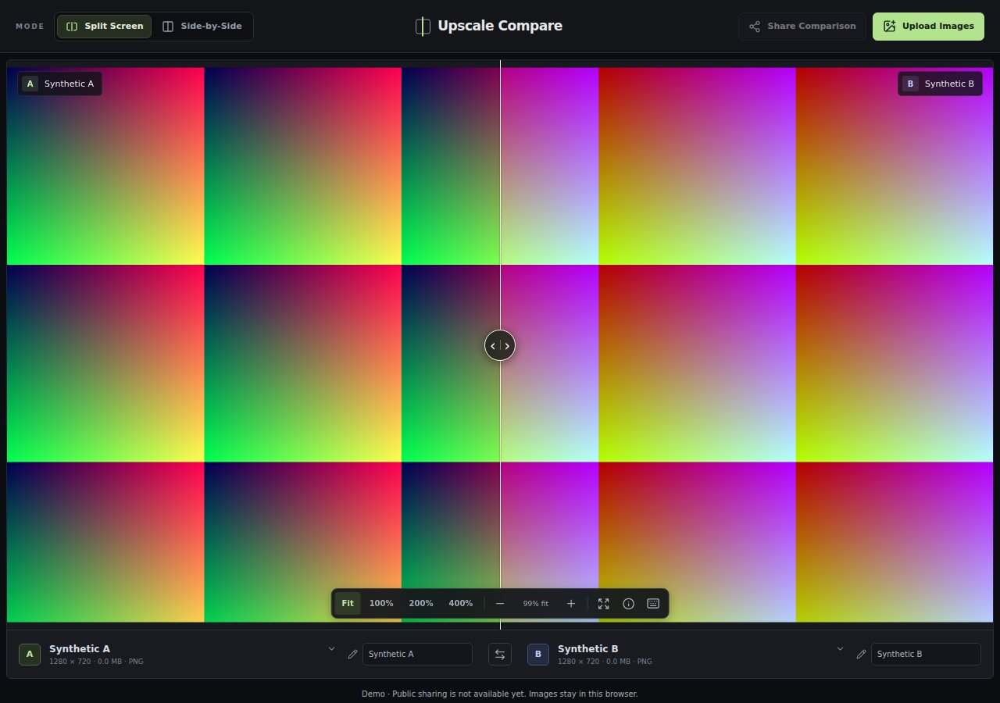
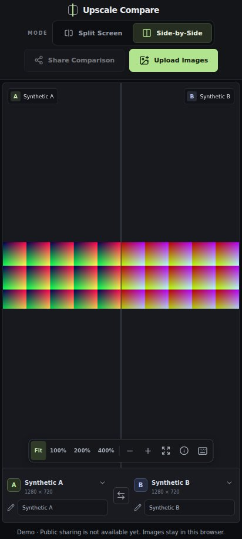

<p align="center">
  
</p>

# Upscale Compare

**See the difference between your game screenshots.**

Compare DLSS, FSR, XeSS, other anti-aliasing methods or any two images with synchronized
zoom and precise pixel inspection. Open two to four screenshots, choose your A/B
pair, and inspect the originals locally.

**[Open the web app](https://kuba25x.github.io/upscale-compare/) ·
[Download Android Preview APK](https://github.com/Kuba25x/upscale-compare/releases/download/v0.1.0-android-preview.1/upscale-compare-debug.apk) ·
[Report an issue](https://github.com/Kuba25x/upscale-compare/issues)**

> **Android Preview is available.**
> [v0.1.0-android-preview.1](https://github.com/Kuba25x/upscale-compare/releases/tag/v0.1.0-android-preview.1)
> is an early preview distributed as a **debug APK**.
> **Share Comparison is not publicly available** in the web app or Android APK.

## Made for close inspection

- **Split Screen** with a draggable divider, or synchronized **Side-by-Side**.
- **Fit, 100%, 200% and 400%** zoom. At 100%, one source pixel maps to one physical
  display pixel, including on high-density screens.
- Mouse-wheel zoom, drag-to-pan, one-finger pan and two-finger pinch.
- Two to four PNG, JPEG or static WebP originals, editable labels and quick A/B swapping.
- Correct aspect ratios and common pixel scale for images with different dimensions.
- Minimalist comparison mode on Android and mobile web; desktop browser fullscreen.
- A compact Android landscape interface with expandable image controls.
- **Original bytes stay intact:** importing/comparing never recompresses or resizes
  the source files. Fit scales the displayed view, not the file.

## Screenshots

Actual screenshots of the running web app, captured with the repository's
synthetic test images. These are not game footage, Android device photographs
or UI mockups. [Capture instructions and provenance](docs/SCREENSHOTS.md).

**Desktop — Split Screen**



**Mobile web — Side-by-Side**



## Web or Android?

|                         | Web app                                            | Android Preview APK                                   |
| ----------------------- | -------------------------------------------------- | ----------------------------------------------------- |
| Start                   | Open the link in a modern browser                  | Install the APK from Releases                         |
| Local comparison        | Yes; no image upload                               | Yes; bundled app works offline                        |
| Image selection         | Browser file input                                 | System Photo Picker; Browse files / Files alternative |
| Session storage         | Browser memory; refresh loses the local comparison | Original copies and session in private app storage    |
| File ceiling            | 20 MiB per file                                    | Provisional 256 MiB per file                          |
| Image bounds            | 36 million pixels; 16,384 pixels per side          | Same pixel/dimension bounds                           |
| Public Share Comparison | Unavailable                                        | Unavailable                                           |

Both versions accept two to four images and share the comparison geometry.
A file passing the Android size ceiling is not guaranteed to decode successfully.
4K/8K memory use depends on the device and WebView; Xiaomi 15T / Android 16
qualification is still pending.

The web app needs its assets loaded from the website; it does not offer an
installed PWA or a guaranteed offline cache. Once loaded, local comparisons do
not send your images to a server. The APK contains the frontend and needs no
GitHub Pages, Cloudflare or network connection to compare successfully imported
local images. Cloud-backed Photo Picker items need to finish downloading and
copying before they are available offline.

## Download and install Android

Requires **Android 7.0 or later** and an up-to-date Android System WebView.
No computer or developer tools are needed.

1. [Download the Android Preview APK](https://github.com/Kuba25x/upscale-compare/releases/download/v0.1.0-android-preview.1/upscale-compare-debug.apk)
   on your Android device.
2. Open the downloaded file. If prompted, allow **Install unknown apps** for
   your browser or file manager, then return to the installer.
3. Tap **Install**, open Upscale Compare and select two to four screenshots.

See the [release page](https://github.com/Kuba25x/upscale-compare/releases/tag/v0.1.0-android-preview.1)
for notes, checksums and source files. This preview is distributed through GitHub
Releases, not Google Play. Xiaomi 15T with Android 16 is the primary target;
physical-device qualification is still pending, including on older Android versions.

Originals are streamed into private app storage with SHA-256 verification. Your
source files are not edited or deleted. A completed session can be restored
offline after restarting the app. Use **Clear comparison** to remove its private
copies; uninstalling or clearing app data deletes the session and stored originals.
Copies use real device space: up to 1 GiB per committed comparison, with a bounded
replacement allowance and a free-space reserve. See [storage and limits](docs/ANDROID.md#storage-and-lifecycle).

[Android guide and device checklist](docs/ANDROID.md) ·
[Owner release/signing runbook](docs/ANDROID_RELEASE.md)

## Quick start for contributors

For the local frontend-only version, no Cloudflare account is needed:

```sh
npm ci
npm run dev:demo
```

Open the URL printed by Vite. Use Node 24 in CI (minimum Node 22.12 for the web
toolchain). Android builds use pinned Node 24.19.0, npm 11.9.0, JDK 21 and the
committed Gradle wrapper.

```sh
npm run build
npm test
npm run test:e2e
npm run test:demo
npm run test:android:web
npm run test:pwa:build
```

See [development and controls](docs/DEVELOPMENT.md),
[testing](docs/TESTING.md), [contributing](CONTRIBUTING.md) and
[Android builds](docs/ANDROID.md). New UI strings, code and documentation are in English.

## Technical documentation

Public sharing remains unavailable. Backend code and local test tools are retained
for development; production Cloudflare workflows remain locked. No preview release
enables hosting, public uploads or billing. PWA installation is not a shipped feature. Web builds prepare
[manifest/icons and isolated worker artifacts](docs/PWA_BUILDS.md); worker registration
and offline/update flows remain disabled.

| Topic                                     | Documentation                                                                                                                                  |
| ----------------------------------------- | ---------------------------------------------------------------------------------------------------------------------------------------------- |
| Architecture and API                      | [Architecture](docs/ARCHITECTURE.md), [API](docs/API.md)                                                                                       |
| Original bytes and image geometry         | [Fidelity and restoration](docs/ORIGINAL_FIDELITY.md), [resource limits](docs/RESOURCE_LIMITS.md)                                              |
| Security, privacy and deletion            | [Security](SECURITY.md), [privacy](docs/PRIVACY.md)                                                                                            |
| Deployment and production locks           | [Deployment](docs/DEPLOYMENT.md), [operations](docs/OPERATIONS.md)                                                                             |
| Cost policy and emergency stop            | [Free-tier operations](docs/FREE_TIER_OPERATIONS.md), [cost controls](docs/COST_CONTROLS.md)                                                   |
| Local sharing tests and recovery          | [Validation](docs/LOCAL_SHARING_VALIDATION.md), [recovery](docs/PUBLICATION_RECOVERY.md), [retries](docs/PUBLICATION_RETRIES.md)               |
| Research and outstanding feasibility work | [Sharing](docs/FREE_SHARING_FEASIBILITY.md), [storage](docs/FREE_STORAGE_RESEARCH.md), [execution](docs/FREE_VALIDATION_EXECUTION_RESEARCH.md) |
| Project status                            | [Progress](PROGRESS.md)                                                                                                                        |

## License

Upscale Compare is licensed under **AGPL-3.0-only**. See [LICENSE](LICENSE).
Redistributing an APK requires its Corresponding Source and applicable notices;
modified hosted versions also have network-source obligations.

[Frontend dependency notices](public/third-party-licenses.txt) are generated with
npm run notices. Android adds Capacitor, tslib and native runtime notices to the APK;
the release preparation bundle includes exact project/dependency source and a
resolved inventory. See [distribution requirements](docs/ANDROID_RELEASE.md#license-and-dependency-distribution).
