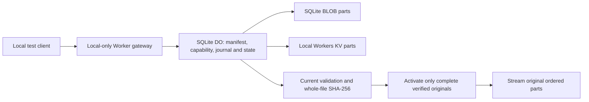

# Free-only sharing: local storage and complete-codec research

**2026-10-31.** Base: current `main`
[`ec6ff358dc795eee960ae6c88661ff4832eb0c6d`](https://github.com/Kuba25x/upscale-compare/commit/ec6ff358dc795eee960ae6c88661ff4832eb0c6d),
including stages 1–7 and the [first feasibility report](FREE_SHARING_FEASIBILITY.md).
This is a separately authorized research step, **not stage 8**. Experiments are
under [`research/free-sharing/`](../research/free-sharing/README.md). No application
code, production binding/configuration, migration, dependency, workflow, security
control or deployment lock was changed. Research dependencies have their own lockfile.
No remote Cloudflare call, resource, subscription, upload or deployment was used.

## Recommendation and current verdict

**Prefer SQLite-backed Durable Objects as the original-byte storage candidate,
with the existing D1 authority for the global directory, quotas, stop generations
and durable takedowns. Do not replace production R2 or deploy this candidate yet.**

The local SQLite prototype preserves exact originals, provides immediate
read-after-activation and avoids KV's eventual propagation and low write allowance.
It is therefore the better starting point for retaining instant public links.
This is an architecture recommendation for further work, not an approved migration.

The complete requested combination is **still unproven**:

1. Public documentation still does not unambiguously establish that a Free
   SQLite DO gets 30 seconds rather than the general Free Worker limit. We have
   not assumed the more favorable interpretation or contacted Cloudflare.
2. The tested full JPEG/WebP WASM decoders improve rejection, but their 8K retained
   allocation is approximately **279–392 MiB**, incompatible with a 128 MB isolate.
   More CPU does not fix this memory design.
3. Local success does not establish provider CPU, peak isolate memory, quotas,
   distributed durability, global availability or physical/backups erasure.
4. Exhausted write capacity can prevent a durable deletion marker. This is an
   explicit prototype limitation requiring protected deletion capacity and a
   visibility/edge stop independent of the exhausted store.

To retain all currently admitted 4K/8K originals, a future implementation needs a
bounded validation-only decoder, not these full-RGBA wrappers. If DO's larger CPU
allowance is confirmed, that decoder could execute inside a DO. Otherwise a real
resumable validator must split **decoded work and durable codec state** across
10 ms invocations. Neither decoder redesign is implemented or certified here.
No recompression, resize, client-only validation or paid fallback is proposed.

## 1. Durable Objects CPU: authoritative sources and the unresolved question

Sources were rechecked on 2026-10-31:

| Source                                                                            | Relevant documented statement                                                                                                            | What it establishes                                                                |
| --------------------------------------------------------------------------------- | ---------------------------------------------------------------------------------------------------------------------------------------- | ---------------------------------------------------------------------------------- |
| [DO limits](https://developers.cloudflare.com/durable-objects/platform/limits/)   | DO CPU table gives a default 30 seconds and incoming-request reset semantics, while its introduction also refers to Workers plan limits. | A DO-specific default is documented, without an explicit Free/Paid CPU split.      |
| [DO FAQ](https://developers.cloudflare.com/durable-objects/reference/faq/)        | Refers to the same per-invocation limits as Workers and also describes a default 30 seconds.                                             | Does not explicitly settle which Free rule overrides the other.                    |
| [Workers limits](https://developers.cloudflare.com/workers/platform/limits/)      | Free HTTP CPU is 10 ms; isolate memory is 128 MB including WASM.                                                                         | The thin outer Worker must fit this envelope.                                      |
| [DO pricing](https://developers.cloudflare.com/durable-objects/platform/pricing/) | SQLite DO is offered on Free; over-limit operations fail.                                                                                | Free availability and billing/quota behavior, not a plan-specific CPU entitlement. |

The launch [Cloudflare article about Free DO](https://blog.cloudflare.com/building-ai-agents-with-mcp-authn-authz-and-durable-objects/)
confirms product availability but does not resolve that CPU distinction. Local
workerd's default execution budget is not the account's production entitlement.
Stream waits, callbacks, a DO name change or omitting `cpu_ms` are not evidence
of a larger Free allowance. No paid CPU setting or compatibility change was made.

### Exact clarification to obtain from Cloudflare

The owner can submit the following as a plan-specific question; **it has not been sent**:

> For an account on Workers Free only, with a SQLite-backed Durable Object and
> no Paid subscription or custom CPU setting, does each DO `fetch`, RPC call and
> alarm receive 30,000 ms of active CPU, or is any of them capped at 10 ms? Please
> identify the authoritative Free-plan rule and explain how the DO table/FAQ
> relates to the Workers Free HTTP table. Is the outer Worker's 10 ms budget
> separate from the DO budget, including returned response streams? Which requests
> reset the DO CPU allowance, and can overlapping requests share or consume it?

Also confirm the exact Free per-object SQLite size: the limit table says 10 GB
generally, while the FAQ describes 1 GB on Free. This research uses at most
40 MiB originals per comparison/object and does not depend on a favorable answer.
Ask for plan-specific memory/concurrency, row-quota enforcement and retention
details before using them in an admission policy. No plan upgrade is authorized.

**Decision rule:** until clarified, only the conservative 10 ms model may be
used as an approved execution assumption. Even a written 30-second clarification
would not certify the implementation's real resource use or authorize deployment.

## 2. What was implemented locally

Both prototypes use actual Miniflare/workerd SQLite-backed DOs. One comparison
has one actor and a private owner capability. In the SQLite variant its original
bytes are SQL BLOB segments. In the KV variant its bytes are KV values while the
same strongly consistent SQLite actor owns the journal/visibility state. Thus
the KV variant is **KV storage plus a DO coordinator**, not an unsafe KV-only
transaction/lock simulation.

This diagram describes the storage experiment, not an application deployment.
The current validator in its finalizer retains the production JPEG/WebP
limitations. Complete codec decoding is tested separately and has **not** been
integrated into publication. Storage success cannot be reported as a security-
complete Share Comparison implementation.

Protocol and invariants:

- A bounded begin request pins normalized comparison settings, ordered file
  lengths/types/hashes, backend and owner capability. It reserves original-byte
  capacity. Conflicting retries fail; deletion leaves an unreusable tombstone.
- At most 20 MiB/file, 40 MiB/comparison and two to four images. Each original
  part is at most 1 MiB, safely below the documented SQL row size and KV value
  ceilings. A 20 MiB image uses 20 parts, a 40 MiB comparison uses 40.
- A private SQL journal precedes external KV writes. Part SHA-256 plus immutable
  identity detects conflicting/reordered bytes. Identical ready retries avoid a
  second write. An ambiguous KV write is read back and verified; missing values
  require backoff before a rewrite, respecting the intended per-key rate model.
- Finalization reads every original, verifies part and whole-file hashes and
  all **current** validator/MIME checks, then checks the publishing generation
  before activation. It reassembles one original in memory; this is deliberately
  not claimed to be a portable staged 10 ms validator.
- Public manifest/image access requires active state. Responses use `no-store`,
  `nosniff`, validated MIME and fixed safe filenames. Image output streams the
  original ordered parts; it never stores decoded output or modifies metadata.
- Deletion records logical withdrawal first, then removes at most eight parts
  per call. Interrupted cleanup retains reservation and can resume. A stop
  fences publication but leaves owner cleanup available while resources permit.

Harnesses have explicit local opt-in, a test hostname, no deployment configuration,
local bindings only, `cf: false` and an outbound fetch handler that refuses
networking. No Cloudflare account credentials are read. Research fault/quota
headers and raw limit probes are intentionally unsuitable for production use.

### Tests and failure recovery

The independent research suite passed **61 tests**:

| Group                                |                 Cases | Evidence                                                                                                                                                                                                                                                                                                 |
| ------------------------------------ | --------------------: | -------------------------------------------------------------------------------------------------------------------------------------------------------------------------------------------------------------------------------------------------------------------------------------------------------- |
| SQLite/KV storage and failure models |                    45 | Exact-limit 4K/8K originals, mixed codecs, ordered 2/3/4-image manifests, size/part/aggregate limits, capabilities/quarantine, duplicate/conflicting/concurrent parts, stop fencing, integrity mismatch, activation/deletion acknowledgment loss, quota/visibility models and real emulator persistence. |
| Complete-codec candidate             |                    15 | Valid baseline/progressive/lossy/lossless inputs, malformed/truncated/table-corrupt inputs, orientation restrictions and valid input after decoder errors; original SHA-256 unchanged.                                                                                                                   |
| Local workerd WASM compatibility     | 1 matrix of 15 inputs | Precompiled JPEG/WebP WASM modules load, decode valid inputs and reject malformed inputs without eval, remote fetches or production bindings.                                                                                                                                                            |

Restarts reopen actual persisted local SQLite/KV state through pending, active,
deleting and deleted states, preserving ownership and parts. These are **orderly
emulator shutdown/reopen checks**, combined with injected failure/acknowledgment
loss at mutation boundaries. They are not physical power-loss, provider replica
failover, actor eviction or actual Cloudflare quota tests.

The full original-byte test uses a valid 4K PNG and valid 8K PNG, each padded to
20 MiB with a valid ancillary chunk. Both SHA-256 and byte-for-byte equality pass
after public output; original comparison settings match exactly. Mixed small
baseline/progressive JPEG and lossy/lossless WebP originals also round-trip.
These are synthetic workload/correctness cases, not representative user images.
Raw manifest restoration is tested; the production frontend has not been wired
to either backend or newly tested against it.

See [test summary](../research/free-sharing/results/test-summary.json),
[SQLite lifecycle](../research/free-sharing/results/sqlite-large-result.json), and
[KV lifecycle](../research/free-sharing/results/kv-large-result.json).

The existing production image-validation, multipart-upload, operations-guard and
production-configuration unit suites also passed **84 tests**. Research TypeScript
checking, repository formatting, source/link/evidence checks and whitespace checks
passed. The production guard still deliberately exits 1 with all four blockers.
The first restricted-shell guard-test run had a child-process stderr failure;
rerunning in the environment mode that supports local subprocesses/loopback passed
all 84 tests, with no test or guard change. No new production build/browser suite
or hosted-CI success is claimed by these local checks.

## 3. Consistency, privacy, deletion and exhaustion

### SQLite DO

[SQLite DO storage](https://developers.cloudflare.com/durable-objects/api/sqlite-storage-api/)
is transactional and strongly consistent. The prototype keeps visibility and
bytes within one actor in the SQLite variant. Successful activation is followed
immediately by readable originals locally, without a KV propagation wait.
Concurrent same-part writes serialize; failures after committed operations recover
from persisted identity rather than generating duplicate publications.

This does not prove geographically distributed latency or uninterrupted access.
Routing/failover, cold actors, backpressure, slow clients and shared-isolate memory
still matter. Unknown public IDs must be rejected using the D1 directory **before
allocating an actor**: the research gateway allows arbitrary IDs and constructor
schema/control writes, which would be an abuse vector in a public service.

### KV

[KV propagation](https://developers.cloudflare.com/kv/concepts/how-kv-works/)
can take 60 seconds or longer, including cached negative lookups. Even local
read-after-write is not a documented global guarantee. The injected missing-read
case prevents activation, then recovers when visible. A stale physical value
cannot bypass a fresh SQL tombstone. The **real local emulator** immediately
reflects writes; that behavior does not certify the cloud.

KV is therefore a poor primary choice for guaranteed immediate cross-region
opening. It could be an optional read cache only after separate design, without
authoritative visibility state in KV and without a stale/public bypass. Such a
cache consumes additional storage/operations and is not implemented here.

### What deletion guarantees are missing

Public refusal after a successfully persisted logical deletion is tested,
including interrupted physical cleanup. Owner capabilities are never returned in
public manifests. This does not erase downloaded copies, retract already-sent
stream bytes, or establish provider physical/cache/backup erasure timing. Exact
original bytes also retain any original EXIF/ICC/text/private metadata.

The [SQLite storage API](https://developers.cloudflare.com/durable-objects/api/sqlite-storage-api/)
describes point-in-time recovery over the previous 30 days and atomic SQLite
`deleteAll()`. A SQL DELETE test is not proof that historical copies disappear
immediately. Confirm the actual Free backup/retention policy and owner privacy
acceptance. The prototype retains identity tombstones; blindly calling `deleteAll`
would also discard them and permit reuse unless a separate authority prevents it.
Restoring a DO to an old active state must not override a later D1 takedown.

One deliberately passing **limitation test** injects exhaustion of all SQL write
capacity after activation. Deletion then returns 503 and the active manifest
remains readable: the actor cannot persist its tombstone. See
[recorded gap](../research/free-sharing/results/exhausted-takedown-gap.json).
A volatile hide flag would disappear on restart and is not a durable solution.
An eventual production design requires protected deletion headroom, independent
authoritative refusal and an edge shutdown that needs neither DO nor D1 writes.
The last mechanism may need to deny all sharing while preserving the static demo.
That is a requirement to resolve, not an implemented mitigation or permission to
change production controls now.

### Emulator limits are not provider limits

| Experiment                                  | Actual local observation              | Scope                                                                                                        |
| ------------------------------------------- | ------------------------------------- | ------------------------------------------------------------------------------------------------------------ |
| KV value > 25 MiB                           | Rejected                              | Confirms this local API size check.                                                                          |
| Two immediate writes to one KV key          | Allowed                               | Does not enforce the documented one-write/second/key behavior.                                               |
| SQLite BLOB of 2,097,153 bytes              | Allowed                               | The emulator does not establish the provider's documented 2 MB row boundary. Application parts remain 1 MiB. |
| KV missing/stale values                     | Injected deterministically            | A consistency model, not a measured propagation interval.                                                    |
| SQL/KV read/write/delete/storage exhaustion | Injected/refused by research controls | No real account quota was consumed or exhausted; SQL write-call injection is not row metering.               |

Evidence: [KV observations](../research/free-sharing/results/kv-emulator-limits.json),
[SQLite observations](../research/free-sharing/results/sqlite-emulator-limits.json).
Passing model tests establish fail/recovery logic under those inputs, not provider
enforcement, quota-reset timing, a hard CPU limit or production error shapes.

## 4. Operations and zero-charge envelope

[KV Free pricing](https://developers.cloudflare.com/kv/platform/pricing/) includes
100,000 reads, 1,000 writes, 1,000 deletes and 1,000 lists per UTC day, with 1 GB
stored; over-limit operations fail. [KV limits](https://developers.cloudflare.com/kv/platform/limits/)
allow 25 MiB/value and limit repeated writes to one key. Storage does not reset
at midnight. The documented Free behavior is different from R2 overage billing.

[SQLite DO Free pricing](https://developers.cloudflare.com/durable-objects/platform/pricing/)
lists 100,000 requests/day, 13,000 GB-s/day, 5 million rows read/day, 100,000 rows
written/day and 5 GB storage, with failure on exceeded Free quotas. Duration is
active wall time, including waits that prevent hibernation; memory is accounted
at 128 MB per object even when several objects share an isolate. Slow clients
can therefore exhaust duration without much CPU. No background task, alarm,
monitor or retry is assumed free of those counters.

These are documented **provider Free-product caps**, conditional on the account
remaining Free and using no paid add-ons, not alert-based cost estimates. They do
not promise availability, unchanged future terms or zero charges for unrelated
products/domains. No R2 subscription/fallback, account upgrade, paid logging or
paid capacity belongs in this proposal. R2's unresolved zero-overage blocker is
avoided only by a future architecture that does not use R2; it is not fixed in
the existing application by these experiments.

Observed complete local lifecycle for one maximal comparison includes begin,
40 part uploads, finalize, manifest/images, diagnostic status reads and five
bounded deletion calls:

| Meter                                    | SQLite originals | KV originals + SQL coordinator |
| ---------------------------------------- | ---------------: | -----------------------------: |
| DO request handlers through final status |               55 |                             55 |
| Local SQL cursor rows read               |              555 |                            515 |
| Local SQL cursor rows written            |              176 |                            176 |
| KV key reads / writes / deletes          |        0 / 0 / 0 |                   80 / 40 / 40 |

These are prototype counts and local cursor observations, not a billing invoice
or a complete production bound. They exclude the future D1 authority, verification,
account usage, retries, polling expansion, schema/restore/maintenance and decoder
checkpoints. SQL calls are not SQL rows; a synchronous embedded SQL call is not
an external fetch. KV finalization reads 40 parts; viewing one 20 MiB image reads
20 keys, cleanup removes at most eight. Keep the conservative 50-call ceiling in
any real design and include all external bindings/failure paths. There is no
edge CPU/subrequest certification here.

Derived upper bounds before headroom/other usage:

- This segmented KV design spends 40 of 1,000 writes per maximal attempt:
  at most 25 such attempts/day before retries or other writes. Deletes have their
  own separate allowance, which must also retain cleanup reserve. A two-key
  whole-original KV design could use fewer writes, but would not solve global
  consistency or full-validator memory/CPU and is not the measured protocol.
- 1,000,000,000 bytes hold fewer than 24 complete 40 MiB comparisons. Five billion
  bytes give an upper bound of 119 before indexes, journals, quarantine, tombstones,
  retention and other account storage. Neither is a recommended capacity.
- The 55-DO-request lifecycle, plus outer Worker requests and all viewer traffic,
  must fit both actual request allowances. HTTP body chunking, actor reads and
  recovery are not unlimited simply because image bytes are preserved.

The existing [D1 Free envelope](https://developers.cloudflare.com/d1/platform/pricing/)
also needs actual account row/storage accounting for the recommended authority.
Do not assume D1 and DO allowances are one interchangeable pool. Set no final
budgets/retention from these upper bounds; owner decisions and provider evidence
are still needed. Quota exhaustion is an availability and deletion problem even
when Free rules prevent overage charges.

## 5. Required JPEG/WebP validation and tested strengthening

The [validation profile](../research/free-sharing/VALIDATION_REQUIREMENTS.md)
requires complete supported still-image data, bounded resources, integrity of
exact stored originals and every existing security check. It explicitly rejects
partial previews, concealed errors and client-only assurances. Metadata and
unsupported modes must have an explicit policy; full decode is not malware
certification or proof of universal conformance.

The candidate adds [jSquash](https://github.com/jamsinclair/jSquash) JPEG/WebP
WASM decoding after the unchanged server validator, rejecting decoder warnings
and mismatched dimensions/output length. Decoder output is discarded, never
stored or used as a new screenshot. Original hashes remain unchanged.

| Malformed input                                            | Current validator | Added complete-decode candidate |
| ---------------------------------------------------------- | ----------------- | ------------------------------- |
| JPEG headers/EOI, missing tables and blocks                | Accepts           | Rejects                         |
| JPEG entropy truncated, valid EOI retained                 | Accepts           | Rejects warning/error           |
| JPEG oversubscribed Huffman table                          | Accepts           | Rejects                         |
| WebP VP8L header, no coded raster                          | Accepts           | Rejects                         |
| VP8 or VP8L raster truncated, RIFF/chunk lengths corrected | Accepts           | Rejects                         |
| Missing JPEG EOI, truncated RIFF, rotated EXIF             | Rejects           | Retains rejection               |

Valid baseline/progressive JPEG, lossy/lossless-alpha WebP and valid inputs after
rejections pass. The same 15-input matrix works in local workerd using static
compiled WASM imports, without enabling unsafe eval or external module fetches.
See [corpus results](../research/free-sharing/results/codec-tests.json) and
[workerd results](../research/free-sharing/results/workerd-codecs.json).

This improves the tested cases but is not a finished validator: a larger
conformance/differential/fuzz corpus, component/metadata variants, allocator limits
and an audited/reproducible decoder build remain necessary. The independent npm
audit reported no advisories for the research dependencies; it does not inspect
all embedded native codec versions or establish absence of vulnerabilities.

## 6. Large-image CPU and memory results

Environment: Node 24.19.0/V8 13.6.233.17-node.51, local Miniflare
5.20261023.0-beta/workerd 1.20261023.1; JPEG `@jsquash/jpeg@1.6.0` and WebP
`@jsquash/webp@1.5.0`. Synthetic 4K/8K JPEG/WebP workloads are deterministic
RGB noise or constant RGBA, generated with Pillow 12.3.0. Lossy encoding here
creates test inputs; application originals are never converted.

Three measured full-decode rounds after a warm-up; CPU is **Node process CPU**,
excluding codec initialization, structural checks, upload, hashing and storage:

| Input                           | Median CPU, ms | WASM linear memory, MiB | Minimum retained bytes expressed as MiB |
| ------------------------------- | -------------: | ----------------------: | --------------------------------------: |
| 4K baseline JPEG                |        177.682 |                  39.938 |                                  75.615 |
| 4K progressive JPEG             |        269.788 |                  62.875 |                                  98.141 |
| 4K lossy WebP                   |        377.344 |                  48.688 |                                  84.729 |
| 4K constant lossless-alpha WebP |         27.873 |                  38.125 |                                  69.766 |
| 8K baseline JPEG                |        615.488 |                 159.250 |                                 301.959 |
| 8K progressive JPEG             |      1,054.953 |                 250.875 |                                 391.936 |
| 8K lossy WebP                   |      1,515.846 |                 194.500 |                                 338.744 |
| 8K constant lossless-alpha WebP |        146.317 |                 152.062 |                                 278.625 |

The lower bound sums simultaneously retained **WASM linear memory + a distinct
JavaScript RGBA output copy + original encoded bytes**. The probe checks these
buffers are distinct and checks original SHA-256 after decoding. It excludes
runtime/metadata/native/transient allocations and is not a peak isolate measure.
No inference from Node RSS is used. Even the RGBA image at 8K is about 126.6 MiB;
retaining it twice is already incompatible with 128 MB. The same wrapper design
therefore cannot preserve the requested full 8K profile in a Worker/DO isolate,
regardless of whether CPU is 10 ms or 30 seconds. This is a design/allocation
finding, not an edge measurement.

4K progressive already exceeds the proposed 96 MB safety target in this lower
bound, before runtime/input-queue overhead. Other 4K cases are not automatically
safe: concurrent requests, cold instantiation and retained WASM heaps matter.
Local small-fixture workerd compatibility is not a 4K/8K memory/CPU certificate.
The isolated decoder Worker includes a conservative large-raster refusal; it is
not a workaround for retaining full 8K functionality.

The unchanged PNG validator was also remeasured locally with three warmed rounds:
4K RGB grid median **60.393 ms**, 8K RGBA8 zero raster **505.252 ms**, and 8K
RGBA16 zero raster **762.657 ms** process CPU. It streams full decompression and
does not retain an entire decoded raster. Thus its memory design differs from
the JPEG/WebP wrappers, but actual native/queue/isolate peaks remain unknown.
The previous report's hash/multipart/CRC results remain separate historical runs.

See [full-codec samples](../research/free-sharing/results/codec-resources.json),
[PNG samples](../research/free-sharing/results/png-resources.json), and
[fixture catalog](../research/free-sharing/results/codec-fixtures.json).
These small shared-host samples are **not** edge CPU, p95/p99, throughput, a
per-invocation budget or a Free admission certificate. Do not add their medians
to estimate a whole production request.

### Feasible directions still requiring proof

1. **Validation-only bounded decoder.** Decode/check all required bitstream data
   while discarding validated scanlines/tiles; avoid full RGBA return/copies.
   Baseline JPEG scanline handling is a promising starting point. Progressive
   JPEG coefficients need a separate bound or externally staged representation.
   This requires a reviewed custom build/API; the tested wrappers do not offer it.
2. **Codec-specific streaming state.** WebP incremental input APIs alone do not
   guarantee bounded output/state; inspect [libwebp's API](https://developers.google.com/speed/webp/docs/api).
   VP8L's [format](https://developers.google.com/speed/webp/docs/webp_lossless_bitstream_specification)
   includes history, transforms and entropy state. A rolling validator may be
   possible, but requires a full memory/work proof for adversarial streams.
   Cropping, downscaling or decoding only selected tiles would not establish
   validity of omitted data and is not an accepted shortcut.
3. **Conditional DO executor.** With confirmed and owner-accepted DO CPU rules,
   run the bounded validator sequentially inside a DO, with the thin Worker
   forwarding bounded streams. Keep body/hash/native/GC memory accounted and
   apply deadlines/concurrency limits. Local timings suggest substantial work,
   but do not establish whether any format/profile passes provider CPU.
4. **Strict-10-ms staging.** If DO also has 10 ms, or that remains the owner's
   constraint, checkpoint parser/hash/CRC/inflater/codec state durably between
   bounded input **and output** work units. Native streams cannot simply be
   serialized. Replaying the prefix on every part is not bounded linear recovery.
   Extra checkpoint I/O must fit Free requests, rows, storage and cleanup budgets.

If these directions fail, supporting every currently admitted 8K/progressive/
16-bit original with full validation is not feasible in the tested architecture.
The available compromises would be format-specific rejected originals, reduced
publication functionality or leaving sharing off; any change requires the owner.
The local comparison feature and original byte quality should remain intact.

## 7. Candidate architecture, tradeoffs and next decision

For the next separately authorized design step, prefer:

- **Free thin Worker:** check existing D1 identity/admission before touching an
  actor, verify Turnstile for new attempts, enforce global stop/budgets, forward
  bounded parts and stream responses. No full raster or per-byte multipart loop
  in this front controller; actual 10 ms suitability still needs measurement.
- **D1 authority:** retain private retry identity, global reservations, publishing
  generation, public visibility and durable deletion markers. Strong refusal must
  gate every image/manifest alias and fail closed when the authority is unavailable.
- **SQLite DO per comparison:** own pending parts and immutable manifest binding,
  bounded server validation and part/file hashes; activate only after complete
  validation. Use a fenced readiness/activation protocol with D1 and idempotent
  recovery, rather than pretending two stores share a transaction.
- **Original output:** stream ordered immutable BLOBs exactly. Delete logically
  through the authority first, then reclaim bounded actor data; preserve takedowns
  across backup restores and keep an independent edge stop.

Only the storage primitive/journal subset exists in the research prototype. Global
admission, real verification, D1/DO commit recovery, durable background maintenance,
complete bounded codecs, production integration and controls remain future work.

| Choice                                      | Cost protection on actual Free  | Instant sharing                               | Main implementation/security/reliability tradeoff                                                            |
| ------------------------------------------- | ------------------------------- | --------------------------------------------- | ------------------------------------------------------------------------------------------------------------ |
| SQLite DO originals + existing D1 authority | Documented quota failure; no R2 | Strong storage semantics suit immediate reads | Best candidate, but CPU entitlement, decoder memory, deletion reserves and two-store fencing are unresolved. |
| KV originals + strong coordinator           | Documented quota failure; no R2 | Cross-region immediacy cannot be guaranteed   | Lower write/storage allowance, propagation/recovery complexity, same decoder problem.                        |
| Full-RGBA WASM decoder in either store      | Does not fix storage choice     | Codec execution can block activation          | Tested 8K allocation incompatible with 128 MB; reject this implementation.                                   |
| Static/operator-curated publication         | Can avoid R2                    | Loses automatic instant publication           | Different workflow/privacy/retention; fallback only if the owner changes the functional goal.                |

**Recommended next decision:** keep production locked and prioritize Cloudflare's
plan-specific clarification plus a bounded validation-only decoder spike. Storage
feasibility is encouraging; the full security/resource combination is not solved.
Do not spend implementation effort migrating production storage before the 8K
validator has a credible CPU/memory design. No stage-8 authorization is implied.

## 8. What still cannot be confirmed without real Cloudflare

All such operations remain outside this authorization:

1. Account-enforced DO CPU entitlement by invocation kind, outer Worker/DO CPU
   accounting, CPU termination and any incoming-request reset interaction.
   First obtain an authoritative clarification; a permissive local runtime is
   insufficient. Any subsequent edge probe needs separate owner approval.
2. Actual cold/warm CPU distributions and maximums for every success/rejection/
   retry/maintenance path, including Turnstile, hashes, D1, stream backpressure,
   native codecs and concurrency. No local statistical p99 or edge metric exists.
3. Peak isolate memory/native queue/GC behavior across multiple requests/objects,
   reliable headroom and real resource termination under the actual Free runtime.
4. Account-wide request/row/storage/duration metering, indexes/DDL/alarms, exact
   quota refusal and reset semantics, per-object size enforcement, and isolation
   from other account products. Injected caps are not provider-meter tests.
5. Global KV positive/negative propagation, actual per-key write throttling,
   distributed DO durability/failover/eviction, real ambiguous transport outcomes
   and cross-region latency. Orderly emulator restarts do not prove these.
6. Physical erasure, cached copies, SQLite PITR/backup retention and restore
   interactions with later takedowns, including the actual Free policy and privacy
   commitments. Local SQL/KV deletion cannot establish a cloud erasure SLA.
7. The real private-origin/DNS/alternate-host setup, verification widget behavior,
   account plan/billing configuration and an emergency refusal drill while storage
   or D1 is unavailable. No resources or settings have been inspected on an account.

Some remaining work is **local**, not a reason to activate Cloudflare yet:
audited bounded codecs, broader conformance/fuzz cases, global-control design,
abuse/deadline/concurrency and cleanup modeling, actual frontend integration and
synthetic end-to-end tests. All need an explicit next implementation scope.
The account must stay Free with no R2/paid fallback; later resource creation,
remote migrations or probes require separate approval. Nothing in this report
removes the existing deployment lock or approves stage 8.
